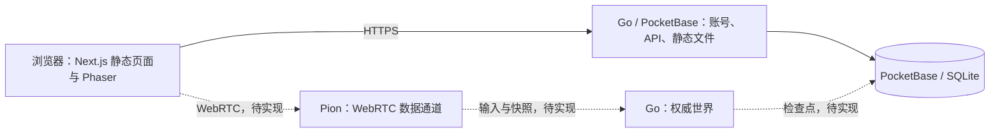

# DLUT Online 产品与技术规范

## 产品定义

DLUT Online 是以大连理工大学为主题、通过浏览器访问的俯视像素多人在线校园游戏。真实校园资料决定内容边界，像素美术负责表达，不以缺乏依据的细节补全校园。

## 架构

## 契约索引

| 文档 | 负责内容 |
| --- | --- |
| [仓库与构建](repository.md) | 源码布局、SSG、单镜像与分支边界 |
| [前端与像素世界](frontend.md) | 页面、Phaser 生命周期、美术与输入 |
| [地理网格与瓦片生成](map-generation.md) | 地理坐标、材质格、连接变体与独立物件 |
| [账号与持久化](backend.md) | PocketBase、API、数据权威和运行配置 |
| [多人通信](networking.md) | WebRTC、可靠性、模拟、恢复与部署目标 |

## 当前实现

已实现基础网页、Next.js 静态导出、PocketBase Go 服务及单镜像构建配置。Phaser 场景提供开发区校区固定视图和设置，地图包含按统一网格生成的地面、湖岸、简化建筑外观和有来源的植被。角色移动、碰撞、账号页面和 WebRTC 游戏会话尚未实现；地图浏览不等于已提供多人游玩。

规范与代码在同一次变更内更新；未实现的需求保持明确状态，不用过程日志替代长期契约。
